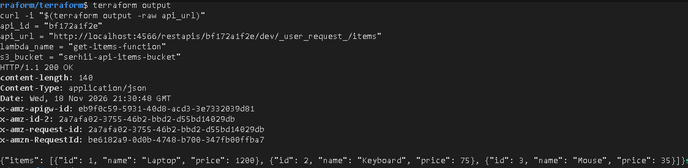

# AWS API (API Gateway + Lambda + S3) на Terraform

## Архітектура
Client → API Gateway (REST) → Lambda (Python 3.12) → S3 (items.json)

Середовище: Floci (локальний емулятор AWS у Docker). Інфраструктура описана в Terraform.

## Запуск
```bash
docker compose up -d
cd terraform
terraform init
terraform apply
curl "$(terraform output -raw api_url)"
```

## Посилання на API
http://localhost:4566/restapis/bf172a1f2e/dev/_user_request_/items

(`api_id` генерується під час кожного `terraform apply`, актуальне значення дивіться в `terraform output api_url`)

## Опис API

### GET /items
Повертає список товарів із файлу `items.json` в S3.

- Метод: GET
- Параметри: немає
- Автентифікація: немає
- Відповідь 200 (`application/json`):
  ```json
  {"items": [{"id": 1, "name": "Laptop", "price": 1200}, ...]}
  ```
- Відповідь 500: `{"error": "<текст помилки>"}`

Приклад:
```bash
curl http://localhost:4566/restapis/bf172a1f2e/dev/_user_request_/items
```

## Структура
- `terraform/` — інфраструктура (S3, IAM, Lambda, API Gateway)
- `lambda/handler.py` — код Lambda
- `data/items.json` — дані, що завантажуються в S3
- `docker-compose.yml` — запуск Floci

## Підтвердження деплою
